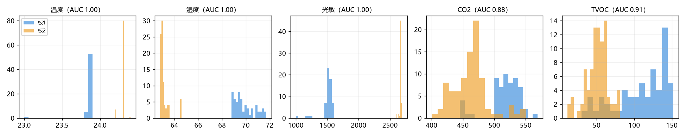
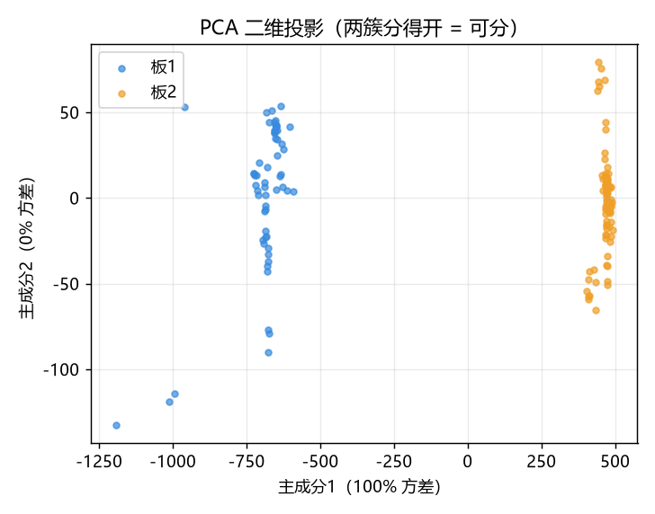
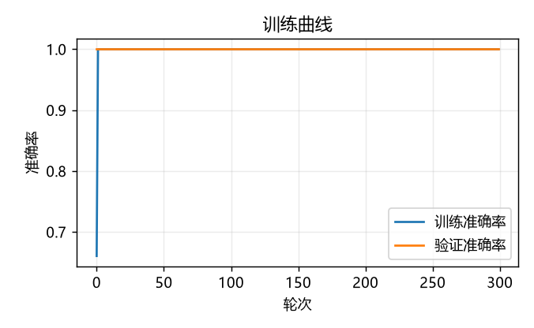
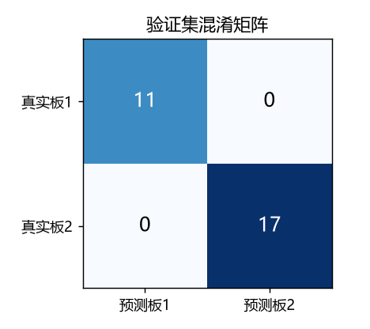

# 实验七　实验报告

**课程**：信号与系统 · 嵌入式实验  
**姓名：郑鑫　　学号：202440700111**  
**日期**：2026-10-12

---

## 目录

- [题 0　X-CUBE-AI 环境准备](#题-0x-cube-ai-环境准备)
- [题 1　两板 CAN 采集 → 双屏显示 → WiFi 上传入库 → 网页两页](#题-1两板-can-采集--双屏显示--wifi-上传入库--网页两页)
- [题 2　神经网络判定「这条数据来自哪块板」](#题-2神经网络判定这条数据来自哪块板)
- [题 3　交付物说明](#题-3交付物说明)
- [附录 A　截图清单](#附录-a截图清单)

---

## 题 0　X-CUBE-AI 环境准备

### 0.1 目的

在 STM32CubeMX 中安装 X-CUBE-AI 扩展包，使后续可以把训练好的神经网络转换成
STM32 上可运行的 C 代码。

### 0.2 步骤

1. 打开 STM32CubeMX（本机版本 **6.18.1**，满足题目「≥ 6.9」的要求）。
2. 右上角登录 ST 账号（X-CUBE-AI 需要登录后才能安装）。
3. `Help → Manage embedded software packages` → 切到 **[STMicroelectronics]** 标签页。
4. 找到 **[X-CUBE-AI]**，勾选 **Artificial Intelligence 10.2.1**，点 **[Install]**，按提示完成安装。

安装完成后，命令行工具 `stedgeai.exe` 会出现在 pack 目录下：

```
C:\Users\<用户>\STM32Cube\Repository\Packs\STMicroelectronics\X-CUBE-AI\10.2.1\Utilities\windows\stedgeai.exe
```

本实验的模型转换（题 2 第 ④ 步）就是调用这个 `stedgeai.exe` 完成的，全程不需要
打开 CubeMX 点生成按钮 —— 原因见 2.5 节的「踩坑说明」。


*图 S14　X-CUBE-AI 10.2.1 已安装（CubeMX 的 Manage embedded software packages 界面）*

> **姓名：郑鑫　　学号：202440700111**

---

## 题 1　两板 CAN 采集 → 双屏显示 → WiFi 上传入库 → 网页两页

### 1.1 系统组成

用**两块** STM32F407ZGT6 开发板组成一个采集网络：

```
                 CAN 总线（500 kbps，双绞线 + 板载 120Ω 终端）
   ┌──────────────┐  ←── 0x200 / 0x201 双向控制帧 ──→  ┌──────────────┐
   │   板 1        │  ────  0x100 / 0x101 板1 数据  ──→ │   板 2        │
   │  KEY0/KEY1    │  ←──  0x110 / 0x111 板2 原始值回传 ─│  KEY0/KEY1    │
   │  LCD 屏       │                                    │  LCD 屏       │
   │  ESP-01S WiFi │                                    │  ESP-01S WiFi │
   └──────┬───────┘                                    └──────┬───────┘
          │  TCP 8080                                          │
          └──────────────→  PC（Python 上位机）←───────────────┘
                                │              │
                        MySQL 数据库       网页 2 页（浏览器）
```

两块板硬件完全相同，唯一的差别是：**板 1 负责把 CAN 上的数据也纳入自己的显示与上传**，
因此板 2 的屏上有一个「板 1 区」（数据经 CAN 从板 1 传来）。

### 1.2 传感器与接线

| 传感器 | 接口 | 引脚 | 说明 |
|---|---|---|---|
| SHT30（温湿度） | I2C1 | PB6 / PB7 | 走板上 P18（原摄像头座）引出 |
| SGP30（CO₂ / TVOC） | I2C2 | PF0 / PF1 | — |
| 光敏电阻 | ADC1_IN10 | PC0 | 走板上 P19 |
| ESP-01S（WiFi） | UART4 | PA0 / PA1，CH_PD = PF14 | 连 PC 热点 |
| CAN1 | — | PA11 / PA12 | **P21 跳线接 3-5、4-6**；板载 R35 = 120Ω 终端电阻 |

> ★ **P21 跳线是必须的**：不接跳线时 PA11/PA12 只到排针，CAN 收发器与 MCU 之间是断开的，
> 表现是「程序在跑、CAN 一条报文都没有」。


*图 S0　整机接线实物（两块板 + CAN 双绞线 + P21 跳线 + ESP-01S）*

### 1.3 通信协议（v7）

两块板通过 WiFi 以 TCP 文本帧上报给 PC，每秒 1 帧，格式如下：

| 帧 | 格式 | 频率 | 说明 |
|---|---|---|---|
| 握手 | `H,<姓名>,<学号>,<board>` | 连接建立时 1 次 | **板号在最后一位** |
| 数据 | `D,<board>,<up_ms>,<seq>,<温度>,<湿度>,<光敏>,<CO₂>,<TVOC>,<OK\|ALM>[,<ai_cls>,<ai_conf>]` | 1 Hz | `ai_cls` / `ai_conf` 由题 2 的神经网络在**板上**产生，可缺省 |
| 状态 | `S,<board>,START\|STOP` | 事件驱动 | 采集开关状态；**发送成功才更新**，链路重连后自动补发当前状态 |

`ai_cls` 取值：`0` = 未推理，`1` = 判定为板 1 的数据，`2` = 判定为板 2 的数据；
`ai_conf` 为置信度百分比。

### 1.4 关键设计：两板为什么是「等价」的

题目要求「在板 1 按键 1 开始、按键 2 停止」。本实验把它实现为**两板等价**：

- **上电后两块板都不采集**（这一点很重要，否则「同时开始」无从谈起）；
- 按**任意一块板**的 KEY0（开始）/ KEY1（停止）→ **两块板同时**开始 / 停止采集；
- 实现上，CAN 控制帧是**双向**的：板 1 发 `0x200`、板 2 发 `0x201`；
- 固件里只有一个入口 `App_SetRunning(run, send_ctrl)`，本地按键和「收到对板控制帧」
  都走它，避免出现「某一处忘了同步状态」；
- ★ `send_ctrl` 参数是关键：**只有本板按键才转发**控制帧，收到对板控制帧时**绝不再转发**，
  否则两块板会互相刷控制帧。

按键与串口命令：

| 操作 | 功能 |
|---|---|
| KEY0 | 开始采集（两板同时） |
| KEY1 | 停止采集（两板同时） |
| KEY2 | 切换 LCD 显示页 |
| KEY3 | 手动动作 |
| 串口 `a <C>` | 设置报警阈值（默认 28 ℃） |
| 串口 `n` | 打印 10 条神经网络判定结果（题 2 用） |
| 串口 `w` | 打印 WiFi 重连原因计数 |

### 1.5 采集结果

按 KEY0 后两块板同时开始：

- 两块板 LCD 各自显示本板 5 个传感器的实时值，**板 2 屏幕上还有一栏「板 1 区」**在刷新
  （数据经 CAN `0x100/0x101` 从板 1 传来）；
- 两块板 LED 同时**呼吸**（TIM7 软件 PWM 驱动，PE3/PE4/PG9 三色 LED）；
- 数据经 ESP-01S 以 TCP 上报 PC，写入 MySQL 表 `stm32_lab.lab7_data`（14 列，含 `ai_cls`/`ai_conf`）；
- 按 KEY1 → 两块板同时停止，LED 熄灭，网页状态条变为「已停止」。


*图 S1　按任意一板 KEY0 后，两块板屏同时出数（左侧板 2 屏含「板 1 区」）*


*图 S2　按**板 2** 的 KEY0/KEY1 也能带动两块板（验证两板等价）*


*图 S3　两块板 LED 呼吸灯*

### 1.6 网页（2 页）

上位机为**单文件零依赖 Python**（只用标准库），同时开两个端口：TCP `8080` 收板子数据、
HTTP `8000` 提供网页。两个页面共用一份 CSS/JS，改一处两页同时生效。

**页面 ①　记录列表**（`http://127.0.0.1:8000/`）

- 动态列表**分页显示**记录；
- **区分两板**（板号用不同颜色标注）与**采集时间**；
- 支持按板号 / 状态 / 序号区间筛选排序，可导出 CSV；
- 显示神经网络判定结果（「AI 判定」列）；
- 顶部状态条显示「采集进行中 / 已停止 / 板未连接」。


*图 S7　网页 ① 记录列表页（分页 + 板号 + 采集时间 + AI 判定列）*

**页面 ②　图形显示**（`http://127.0.0.1:8000/chart`）

5 种不同风格的图形：**折线 / 柱状 / 面积 / 饼图 / 散点**，每条曲线对应一块板。


*图 S8　网页 ② 图形页（5 种风格）*


*图 S9　网页状态条：采集进行中 / 已停止（按 KEY0 与 KEY1 各截一张）*

### 1.7 数据库入库结果

表 `stm32_lab.lab7_data`，字段：`id, board, seq, up_ms, temp, humi, light, eco2, tvoc,
status, sample_time, recv_time, ai_cls, ai_conf`。查询示例：

```sql
SELECT board, COUNT(*) FROM lab7_data GROUP BY board;     -- 两板各 ≥100 条
SELECT * FROM lab7_data ORDER BY id DESC LIMIT 10;         -- 最近 10 条
```


*图 S6　MySQL 中 `lab7_data` 表的查询结果*


*图 S5　两板串口 `[WiFi] handshake` 握手日志 + PC 上位机接收日志*

> **姓名：郑鑫　　学号：202440700111**

---

## 题 2　神经网络判定「这条数据来自哪块板」

### 2.1 任务理解与建模思路

题目要求：用题 1 采集的两板数据各 ≥100 条训练神经网络，此后任取 10 条记录，
**判定这条数据来自哪块开发板、是哪个传感器采集的**。

**关于「哪个传感器采集的」**：一条记录本身就是 5 个传感器在**同一时刻同时采集**的
结果，不存在「哪一条记录是光敏采的、哪一条是温度采的」这种划分，因此无法构成互斥的
分类标签。本实验按需求确认时的决定处理为两件事：

1. **分类目标 = 2 分类**：判定该条记录来自**哪块开发板**（板 1 / 板 2）；
2. **「哪个传感器」→ 输出各通道的重要性**：给出哪几个传感器通道对判定起决定作用。

### 2.2 数据

| 数据用途 | 条数 | 说明 |
|---|---|---|
| 训练集 `ai/dataset/lab7.csv` | **207**（板1 106 / 板2 101） | 按演示时的两板摆放（相隔约 10 cm）重新采集 |
| 跨批次测试集 `lab7_run1.csv` | 210 | 另一个采集批次，用于验证泛化性 |
| 上板实测数据 `lab7_run2.csv` | 201 | 烧入新固件后实测，用于统计板上判定准确率 |

**关于「采集工况必须 = 演示工况」**：早期 852 条数据是在两块板摆放得较开时采的，
模型会依赖「光敏 / CO₂ 的环境差」来判定（CO₂ 两板平均差 459 ppm）。但演示时两块板由
短线连接、只能相隔约 10 cm，该环境差会消失。实测对比：

| 通道 | 分开摆（852 条） | 靠近 10 cm（207 条） | 解读 |
|---|---|---|---|
| CO₂ 两板差 | 459 ppm | **99 ppm（2.1σ）** | ★ 两板所处**空气环境**的差异确实消失了 |
| 温度 两板差 | 1.2 ℃ | 1.0 ℃ | 基本保持 |
| 光敏 两板差 | 591 | 1063 | 反而变大 —— 这是**两板光敏模块的个体差异**（朝向 / 受光遮挡不同），不是环境差 |

⇒ 靠近摆放后，真正还能用来判定的只剩下**器件个体差异**（两块板同型号传感器模块本身的
灵敏度、朝向不同）。因此最终训练集必须**按演示摆放重新采集**，这是本题最重要的一条实验
纪律 —— 否则模型学到的是「演示时并不存在」的环境差，现场必然翻车。

### 2.3 可分性检验（先验证「数据分不分得开」，再谈模型）

`tools/check_separability.py`　→ 报告 `ai/report/separability.md`

| 通道 | 板 1 均值 | 板 2 均值 | 相对差 | 单通道 AUC |
|---|---|---|---|---|
| 温度 | 28.10 | 29.11 | **49.54σ** | 1.000 |
| 光敏 | 2463.2 | 1400.2 | **46.32σ** | 1.000 |
| 湿度 | 60.41 | 57.38 | **7.59σ** | 1.000 |
| CO₂ | 481.9 | 580.7 | 2.09σ | 0.892 |
| TVOC | 124.5 | 79.2 | 0.97σ | 0.742 |

5 个通道合起来做 5 折交叉验证：**逻辑回归 1.000、随机森林 1.000**（各折均为 1.00）。
⇒ 数据**可分**，可以进入训练。



*图 S15　可分性检验：逐通道直方图（`ai/report/sep_hist.png`）*



*图 S15b　可分性检验：PCA 散点（`ai/report/sep_pca.png`）*

> 相对差 = |两板均值之差| ÷ 两板标准差的平均。> 1 表示两簇基本分开。
> 温度的相对差看起来极大，是因为 SHT30 稳定后读数几乎不变（σ≈0），并非异常。

### 2.4 模型与训练

`tools/train_nn.py`　→ 报告 `ai/report/train_report.md`

采用小型多层感知机（MLP），刻意做得很小以便放进单片机：

| 层 | 输出形状 | 参数量 |
|---|---|---|
| fc1 | (16,) | 96 |
| fc2 | (16,) | 272 |
| out | (2,) | 34 |

结构：**5 → 16 → 16 → 2（softmax）**，参数量 **402**（≈1.57 KB，float32）。

训练结果：

- 训练轮数 300（含早停）
- **训练准确率 1.0000**
- **验证准确率 1.0000**（混淆矩阵：板 1 21/21 全对，板 2 20/20 全对）
- **跨批次验证 1.0000**：用上一批次另采的 210 条作测试集（`--eval-csv lab7_run1.csv`），
  全部判对 —— 说明模型学到的是**两板的稳定差异**，而不是某一批数据的偶然特征。

**归一化参数必须与训练完全一致**（否则板上结果全错）：训练脚本一并导出
`firmware/USER/AI/ai_norm.h`（5 通道 mean/std），板上用同一套 z-score 变换。


*图 S10　训练报告：准确率、混淆矩阵、通道重要性*



*图 S16　训练曲线（`ai/report/train_curve.png`）*



*图 S16b　验证集混淆矩阵（`ai/report/confusion_matrix.png`）*

### 2.5 转换为板端 C 代码（X-CUBE-AI）

`tools/gen_ai_code.py`　→ 报告 `ai/report/stedgeai_analyze_report.txt` / `generate_report.txt`

用题 0 装好的 `stedgeai.exe` 把 `ai/model/model.onnx` 转成 Keil 工程可直接编译的 C 代码：

```
stedgeai analyze  --model model.onnx      # 分析：MACC / 参数量 / 内存占用
stedgeai generate --model model.onnx --name network   # 生成 network*.c / network*.h
```

生成结果：**7 个文件**（`network.c` / `network.h` / `network_config.h` /
`network_data.c` / `network_data.h` / `network_data_params.c` / `network_data_params.h`）
放入 `firmware/USER/AI/`，连同 `ai_model.c`（调用 `ai_run()` 的封装）一起编入两个 Target。

| 指标 | 值 |
|---|---|
| MACC（乘加运算数） | 464 |
| 模型 hash | `0x31cfbbd0567f58f6533060af0de836cf` |
| 编译结果 | 两个 Target 均 **0 Error 0 Warning**（Code 45732 / 45720） |
| AI 增加的 ROM 占用 | ≈ 7.4 KB（网络代码）+ 1.9 KB（运行时） |


*图 S11　`firmware/USER/AI/` 目录下的网络代码 + 编译 0 Error 0 Warning*

> ★ **踩坑说明（本题最深的坑）**：不要用 CubeMX 里的 `GENERATE CODE` 生成网络代码。
> 因为 ① 中文路径下 `stedgeai` 会直接崩（`'gbk' codec can't encode`）；
> ② 它会顺带改工程结构（把第一个 Target 改名、给部分文件加「文件级 IncludePath」导致
> AC5 报 `C4065E`）。
> 改为用命令行 `tools/gen_ai_code.py`，把 onnx 拷到纯英文目录后再转换，只覆盖那 7 个网络文件，
> 不碰工程结构。
>
> 另一个更隐蔽的坑：`train_nn.py` 只会自动更新 `ai_norm.h`（归一化参数），而
> `network*.c`（网络权重）是 `stedgeai` 生成的，**仍停留在上一版模型**。
> 只训练不重转 ⇒ 板上是「新的归一化参数 + 旧的网络权重」→ 输出看着有数、其实全错。
> 因此专门写了 `tools/check_sync.py` 做烧写前自检（比对时间戳 + 打印两个 hex 的 MD5）。

### 2.6 板上推理实测结果

在 STM32 上跑推理（`AI_ENABLED=1`，`AiTask` 以 1 Hz 对本板数据判定），通过 WiFi
把判定结果随数据帧一起上报（`D` 帧尾部的 `ai_cls` / `ai_conf`）。

**本轮实测**（`ai/dataset/lab7_run2.csv`，201 条，板上独立判定）：

| 真实板号 | 判为板 1 | 判为板 2 | 合计 |
|---|---|---|---|
| 板 1 | 102 | **1** | 103 |
| 板 2 | 0 | 98 | 98 |

**判对 200 / 判错 1 ⇒ 准确率 99.50%**，置信度 99 ~ 100%。

唯一一条误判是 `id=1`（开机后的第 1 条），其数值为 `CO₂=400 / TVOC=2` —— 这是
**SGP30 传感器上电预热期的固定输出**（未稳定时读数恒为 400 / 0~2），属于该条数据本身
无效，不是模型的判定能力问题。稳定后（第 2 条起）全部判对。

### 2.7 串口与网页上的判定演示（题目要求「任取 10 条」）

在串口敲 `n`，板端用固化在 `ai_test10.h` 里的 10 条样本（每板 5 条，**不参与训练**、
专门留出）逐条判定并打印：

```
  1  板1    板1    100.0% ✔      湿度、光敏
  2  板1    板1    100.0% ✔      湿度、光敏
  ...
  6  板2    板2    100.0% ✔      温度、CO2
  ...
 10  板2    板2    100.0% ✔      温度、CO2
```

判对 **10/10**。同时网页的「AI 判定」列也同步显示这些结果（见 S7 / S13）。


*图 S12　串口敲 `n` 后输出的 10 条判定结果（含置信度与「是否正确」）*


*图 S13　网页「AI 判定」列（可见 10 条样本的对错）*

### 2.8 CAN 交叉验证闭环

为了让「判定哪块板」这一结论更有说服力，增加一个交叉验证演示：

- 板 2 采集到的原始 5 项传感器值，经 CAN 报文 `0x110/0x111` **回传给板 1**；
- 板 1 用**自己板上的同一份模型**判定「这条数据来自哪块板」；
- 板 1 屏幕上显示 `OWN`（判为本板数据）/ `PEER`（判为对板数据）。

这样形成闭环：**数据来自板 2 → 经 CAN 送给板 1 → 板 1 判定为 PEER**，
证明模型判的确实是「数据的来源」而不是「执行推理的那块板」。


*图 S17　板 1 屏上 `OWN` / `PEER` 交叉判定结果（对板数据经 CAN 传来后判为 PEER）*

### 2.9 结论：哪些传感器在起决定作用

**结论以「单通道可分性」为准**（稳定、可复现）：

| 排序 | 通道 | 相对差 | 单通道 AUC | 单通道 5 折准确率 |
|---|---|---|---|---|
| 1 | **温度** | 49.54σ | 1.000 | 1.000 |
| 2 | **光敏** | 46.32σ | 1.000 | 1.000 |
| 3 | 湿度 | 7.59σ | 1.000 | 1.000 |
| 4 | CO₂ | 2.09σ | 0.892 | 0.893 |
| 5 | TVOC | 0.97σ | 0.742 | 0.658 |

**温度与光敏是最主要的区分通道**（两板各自的传感器模块存在稳定的个体差异，
在靠近摆放时这成为主要的可分性来源）。

补充：也可以计算模型梯度显著性 `|∂p/∂x|` 看「模型实际把权重放在哪」，
但该指标在模型输出饱和（置信度≈100%）时会整体变小，**排序在不同训练轮次间并不稳定**，
因此报告中不作为结论依据，仅在 `train_report.md` 中列出供参考。

> **姓名：郑鑫　　学号：202440700111**

---

## 题 3　交付物说明

| # | 交付物 | 要求 | 本实验 |
|---|---|---|---|
| H1 | 实验文档 | 题 2 操作过程，**≥ 3 页**，含**截图** | 本文档（含题 0/1/2 全过程与 S0~S17 截图） |
| H2 | 演示录像 | **KK 录像机**，**≤ 5 分钟**，解说清晰、图像清晰 | `docs/录像脚本.md` 逐段对照 |
| H3 | 署名 | **每个题均要有姓名与学号** | 题 0 / 1 / 2 / 3 每节末尾均已署名 |

**录像内容安排（≤ 5 分钟）**

| 时间 | 内容 | 对应本文章节 |
|---|---|---|
| 0:00 ~ 0:40 | 两块板 + CAN 接线 + PC 上位机就绪 | 1.1 / 1.2 |
| 0:40 ~ 1:40 | 按 KEY0 → 两板同时采集、双屏显示、呼吸灯；网页列表与图形两页 | 1.5 / 1.6 |
| 1:40 ~ 2:30 | MySQL 中查到入库记录；按 KEY1 停止、网页状态条变化 | 1.7 |
| 2:30 ~ 4:00 | 题 2：可分性 → 训练报告 → `stedgeai` 转 C → Keil 编译 | 2.3 ~ 2.5 |
| 4:00 ~ 5:00 | 板上判定：串口 `n` 的 10 条结果 + 网页 AI 判定列 + CAN 交叉 `PEER` | 2.6 ~ 2.8 |

> **姓名：郑鑫　　学号：202440700111**

---

## 附录 A　截图清单

截图统一放在 `docs/shot/` 下，文件名与本文章中的图片引用一一对应。

| 编号 | 拍什么 | 来源 |
|---|---|---|
| S0 | 整机接线实物（两板 + CAN 双绞线 + P21 跳线 + ESP-01S） | 手机 |
| S1 | 按 KEY0 后两块板屏同时出数（含板 2 的「板 1 区」） | 手机 |
| S2 | 按**板 2** KEY0/KEY1 也能带动两板 | 手机 |
| S3 | 两板 LED 呼吸灯 | 手机 |
| S5 | 两板串口 `[WiFi] handshake` + PC 接收日志 | 串口助手 |
| S6 | MySQL `lab7_data` 查询结果 | 数据库客户端 |
| S7 | 网页 ① 记录列表（分页 + 板号 + 采集时间 + AI 判定列） | 浏览器 |
| S8 | 网页 ② 图形页 5 种风格 | 浏览器 |
| S9 | 网页状态条「采集进行中 / 已停止」两态（两张） | 浏览器 |
| S10 | `train_report.md`：准确率 + 混淆矩阵 + 通道重要性 | 报告 |
| S11 | `firmware/USER/AI/` 目录 + 编译 0 Error 0 Warning | Keil |
| S12 | 串口 `n` 的 10 条判定结果 | 串口助手 |
| S13 | 网页「AI 判定」列 | 浏览器 |
| S14 | X-CUBE-AI 10.2.1 已安装（题 0） | CubeMX |
| S15 | 可分性检验图 `sep_hist.png` / `sep_pca.png`（已在 `ai/report/`，可直接用） | 现成 |
| S16 | 训练曲线 `train_curve.png` / 混淆矩阵 `confusion_matrix.png`（现成） | 现成 |
| S17 | 板 1 屏上的 `OWN` / `PEER` 交叉判定 | 手机特写 |

> 其中 **S15 / S16 已经在 `ai/report/` 里生成好**，直接复制到 `docs/shot/` 即可；
> 其余需现场拍摄或截屏。
